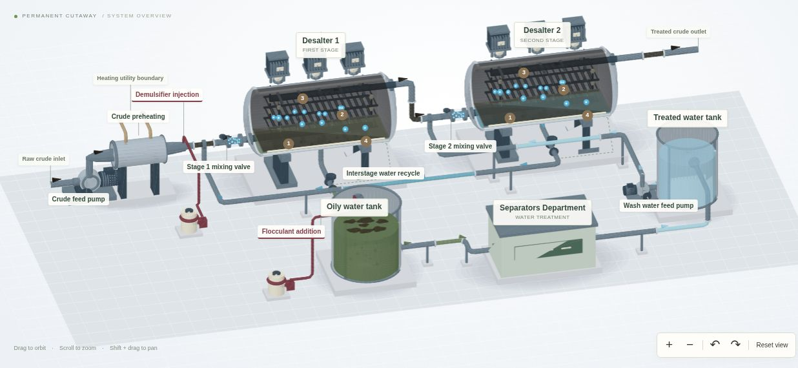

# Two-Stage Desalting System

**Explore the equipment, flow paths and separation principles in interactive 3D.**

### [Open the Interactive Model →](https://ronidavidov56.github.io/desalter-process-analysis/)

*Click the preview to open the live model. Rotate, zoom and explore the connected system in your browser.*

## Project Overview

This project translates a process flow diagram into an interactive spatial model, connecting an overview of the complete system with a closer look at equipment functions and separation mechanisms.

It illustrates how fluid transport, preheating, mixing, chemical treatment and electrostatic separation work together. Demulsifier and flocculant addition points provide context for process evaluation without presenting experimental results.

## Inside the Model

- **Permanent vessel cutaways:** inlet distributors, electrode grids, insulators, upper oil collectors and lower water regions are visible immediately.
- **Connected flow paths:** crude passes through two stages while water separated in stage 2 is reused before stage 1.
- **Feed conditioning:** pumps, preheating, water injection and mixing valves show how the feed reaches each vessel.
- **Chemical treatment:** demulsifier addition is shown before stage 1, with flocculant addition in the oily-water treatment context.
- **Separation animation:** water droplets approach, merge and settle toward the lower water region.
- **Interface control:** a measurement point and control signal connect the internal interface to the water-outlet valve.
- **Water-treatment boundary:** an oily water tank connects to the general Separators Department and its treated-water return.

## Engineering Principles

**Move and mix** — Pumps supply hydraulic energy. Preheating reduces crude viscosity and mixing disperses wash water into the crude.

**Coalesce and settle** — Demulsifier helps destabilize the emulsion. The electric field promotes droplet coalescence and larger water drops settle under gravity.

**Control and circulate** — Interface control regulates water withdrawal. Interstage reuse and the supporting water circuit connect the separation stages with downstream water treatment.

## Explore the Workflow

| Action | Control |
| --- | --- |
| Rotate the model | Drag |
| Zoom | Scroll, pinch or use + / − |
| Pan | Shift + drag or two-finger drag |
| Inspect vessel internals | Select **Inside stage 1** or **Inside stage 2** |
| Follow the water circuit | Select **Water circuit** |
| Read equipment explanations | Select a label or use the equipment dropdown |
| Pause or resume motion | Use **Pause motion / Play motion** |
| Restore the overview | Select **Reset view** |

With the model canvas focused, arrow keys rotate, + / − zoom and Home restores the overview. Reduced-motion preferences start the animation paused.

## Implementation

Built with **JavaScript, Three.js, HTML and CSS**, with static hosting on **GitHub Pages**. The viewer includes a software compatibility renderer for browsers without WebGL.

The latest distribution includes a self-contained `index.html` for straightforward publication. The editable modular source is supplied separately in the project update package.

## Model Scope

Equipment dimensions, routing, internal geometry, liquid levels and animation timing are illustrative. This is an educational visualization rather than an as-built reconstruction or a validated process simulation.

The Separators Department is a general treatment boundary. Its internal operations and a complete water balance are outside the model scope. Chemical addition points do not establish product selection, dosages, implementation outcomes or treatment performance.

<strong>Technical references</strong>

- [Axsia Howmar — Electrostatic coalescers](https://axsiahowmar.com/solutions/crude-oil-treatment/electrostatic-coalescers/): generic internal arrangement and separation principles.
- [SLB — Chemical demulsifiers](https://www.slb.com/products-and-services/innovating-in-oil-and-gas/well-production/production-chemicals-and-services/demulsifiers): chemical destabilization of emulsions to support droplet coalescence.
- [SLB / Schlumberger — BILECTRIC HF product sheet](https://www.gmsthailand.com/wp-content/uploads/2021/09/brochure.pdf): major equipment components and process operation; manufacturer-authored document hosted by GMS.
- [Shell — WO2018081214A1](https://patents.google.com/patent/WO2018081214A1/en): a published example of desalter emulsion detection and control.
- [Alfa Laval — Crude oil desalting](https://www.alfalaval.us/industries/energy-and-utilities/crude-oil-refinery/crude-oil-processing/crude-oil-desalting/): heat-exchange context for desalting systems.

The model uses original explanatory geometry informed by public references. No manufacturer affiliation or identical installed equipment is implied.

---

**Roni Davidov · Engineering Portfolio**  
*Two stages. One connected process.*
