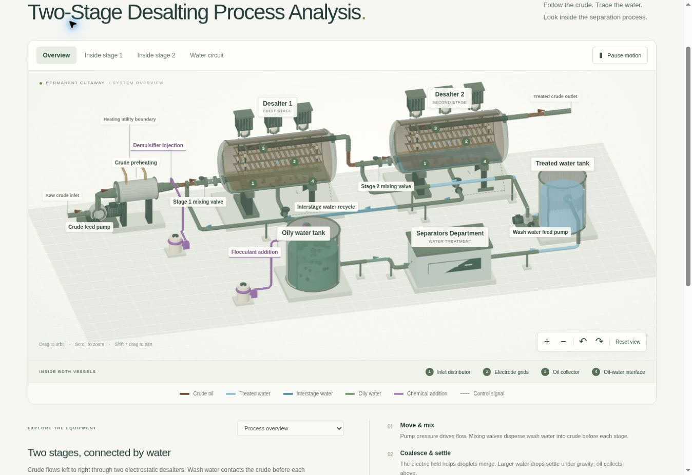

# Two-Stage Desalting Process Analysis

An interactive 3D engineering visualization that makes system components, process flows, and their interconnections easier to understand.

**[Explore the Interactive 3D Model →](https://ronidavidov56.github.io/desalter-process-analysis/)**

*Model overview. Open the live version to rotate, zoom, explore equipment, and follow the animated flow paths.*

## Project Overview

This project translates a process flow diagram into an interactive spatial model. It connects an overview of the complete system with a closer look at the equipment and the mechanisms operating inside it.

The visualization provides context for process analysis and the evaluation of alternative demulsifiers and flocculants. It emphasizes system understanding, equipment functions, and the relationships between process stages.

## Project Objectives

- Illustrate the equipment, process streams, and water circulation.
- Examine the process and the role of chemical treatment.
- Communicate engineering concepts through a clear, interactive model.

## Explore the Model

- **Two permanent vessel cutaways:** see the inlet distributors, electrode grids, upper oil collectors, and lower water regions immediately.
- **Connected process streams:** follow the crude through both stages and trace the countercurrent interstage water reuse.
- **Supporting equipment:** explore feed pumps, crude preheating, wash water mixing, and chemical addition points.
- **Separation mechanisms:** observe illustrative water-droplet coalescence and gravitational settling.
- **Water treatment boundary:** see the connection to the general Separators Department and the treated-water return.
- **Interface control:** understand the relationship between interface measurement and water withdrawal.

## Controls

| Action | Control |
| --- | --- |
| Rotate | Drag the model |
| Zoom | Scroll, pinch, or use the + / − buttons |
| Pan | Shift + drag, or two-finger drag |
| Inspect a stage | Choose **Inside stage 1** or **Inside stage 2** |
| Read equipment explanations | Select a label or use the equipment dropdown |
| Stop or resume motion | Use **Pause motion / Play motion** |
| Return to the overview | Use **Reset view** |

Keyboard controls are also available when the model canvas has focus: arrow keys rotate, + / − zoom, and Home returns to the overview.

## Implementation

Built with JavaScript, Three.js, HTML, and CSS, and hosted on GitHub Pages. The model supports a software compatibility renderer when WebGL is unavailable. Reduced-motion preferences start the illustrative animation paused.

## Scope and Assumptions

This is a schematic educational visualization, not an as-built reconstruction or a validated process simulation. Equipment dimensions, internal geometry, liquid levels, pipe routing, and animation timing are illustrative.

The Separators Department is represented as a general water-treatment block; its internal operations are outside the project scope. The water return does not imply complete recovery or a fully closed water balance.

Chemical addition points illustrate their process context. No chemical products, dosages, implementation outcomes, operating values, or experimental results are claimed.

## Technical References

- [Axsia Howmar — Electrostatic coalescers](https://axsiahowmar.com/solutions/crude-oil-treatment/electrostatic-coalescers/): generic three-grid internal arrangement and separation principles.
- [SLB / Schlumberger — BILECTRIC HF product sheet](https://www.gmsthailand.com/wp-content/uploads/2021/09/brochure.pdf): manufacturer-authored reference hosted by GMS, covering major components and the desalting process.
- [Shell — WO2018081214A1](https://patents.google.com/patent/WO2018081214A1/en): a published design example concerning emulsion detection and desalter control.

The model uses original explanatory geometry. Reference links do not imply manufacturer affiliation or identical installed equipment.

---

**Roni Davidov · Engineer | M.Sc. in Mechanical Engineering**
